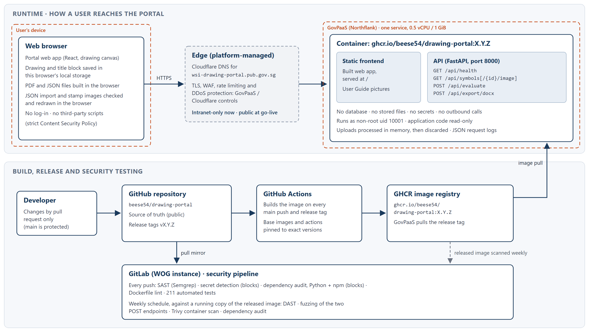

# System Architecture — Schematic Drawing Portal

Current as of release **1.4.0** (November 2026). The service performs no AI or model inference of any kind.

## 1. Summary

| Item | Value |
|---|---|
| Purpose | Draw a water service installation schematic, check it against PUB requirements, and export it as PDF and JSON |
| Hosting | GovPaaS (Northflank-based), one container |
| Address | `wsi-drawing-portal.pub.gov.sg` |
| Exposure | Non-production: intranet only. Production: public internet at go-live |
| Users and log-in | No log-in, no accounts, no sessions |
| Data stored by the server | None. No database, no stored files |
| Secrets held by the application | None |
| Outbound calls from the server | None |
| Code and image | Source on GitHub (`beese54/drawing-portal`, public), mirrored to GitLab; image `ghcr.io/beese54/drawing-portal:X.Y.Z` |

## 2. Architecture diagram

Two dashed boundaries in the diagram mark where trust changes: the **user's device** (everything there is under the user's control) and the **GovPaaS service** (the only code PUB runs). The edge between them is managed by GovPaaS and Cloudflare, not by this project.

## 3. Components

### 3.1 Frontend (runs in the user's browser)

- React and TypeScript, built with Vite. The drawing canvas uses Konva. State is kept with Zustand.
- A single page with no client-side routing and no log-in screen.
- **Saved in the browser's local storage** (on the user's computer only): the drawing (symbols, pipes, annotations) and the sheet settings, including the title block. The title block can hold names, addresses, emails, phone numbers and stamp and signature images. None of this is sent anywhere unless the user runs an evaluation or a Word export.
- **Built in the browser:** the PDF drawing (jsPDF) and the JSON data file. Neither involves the server.
- **User Guide:** part of the app, shown in place of the canvas. Its pictures are static files served by the container.
- **Links to other sites:** the PUB logo and the footer links (Contact Us, Feedback, Report Vulnerability, Privacy Statement, Terms of Use) open in a new tab. An optional pilot survey link (FormSG) is built in but **switched off** in 1.4.0. When on, no drawing data is added to it.
- Calls the API with relative paths, so every request is same-origin.

### 3.2 Backend (in the container)

- FastAPI on uvicorn, port 8000, Python 3.12.
- **Compliance checks:** eight deterministic rule functions in `backend/app/agents/` (backflow prevention, supply mode, water efficiency, tank and pump, long bath, hot water contamination, section 3 pipes, highest direct-supply fitting). Despite the folder name, nothing here is an AI agent.
- **Word report:** python-docx builds the report in memory and streams it back.
- **Symbol library:** SVG files and `manifest.json`, built into the image and read-only.
- **Static files:** the built frontend is served from `/`.

### 3.3 Container image

- Multi-stage `Dockerfile`: stage 1 builds the frontend on `node:24-alpine`; stage 2 runs on `python:3.12-alpine`. Both base images are pinned by `sha256` digest.
- Runs as a non-root user (uid 10001). The application code is owned by root, so the app can read and run it but not change it. The only writable place is `/tmp`, where uploads over 1 MB are briefly spooled.
- Python dependencies are installed from a lockfile with hashes; npm from `package-lock.json`.

## 4. API endpoints

There are five API endpoints. All are unauthenticated by design: there is no user concept.

| Method and path | Purpose | Input | Limits |
|---|---|---|---|
| `GET /api/health` | Liveness and readiness; reports version and commit | None | — |
| `GET /api/symbols` | List the symbol library | None | Read-only |
| `GET /api/symbols/{id}/image` | One symbol's SVG | Symbol id | Read-only; id must be in the manifest |
| `POST /api/evaluate` | Run the eight compliance checks | `metadata_json` (form field); optional schematic image | Metadata ≤ 20 MB; ≤ 1,000 elements, 2,000 pipes, 4,000 ports; image ≤ 10 MB and ≤ 25 million pixels, PNG or JPEG |
| `POST /api/export/docx` | Build the Word compliance report | `manifest_json` (form field); cropped canvas images | Manifest ≤ 4 MB, ≤ 1,000 rows; ≤ 200 images, ≤ 8 MB each, ≤ 32 MB in total, PNG or JPEG |

`/docs`, `/redoc` and `/openapi.json` are switched off in the deployed image and return 404.

## 5. Data flows

- **Drawing.** Happens entirely in the browser. The drawing is saved in the browser's local storage.
- **Evaluate.** The browser sends the drawing as JSON to `POST /api/evaluate`. The server runs the checks and returns a JSON result. Nothing is kept.
- **Word report.** The browser sends the result rows and cropped pictures of the canvas to `POST /api/export/docx`. The server builds the document in memory and returns it. Nothing is kept.
- **PDF and JSON export.** Built in the browser and downloaded directly. The server is not involved.
- **JSON import.** Read and checked entirely in the browser. It never reaches the server.
- **Logs.** One structured JSON line per request on stdout: request id (also returned as `X-Request-ID`), method, path, route, status and duration. Request bodies, query strings, headers and client IP addresses are deliberately not logged. Successful health checks are not logged.

## 6. File uploads and imports

| Input | Where it is handled | Checks |
|---|---|---|
| Schematic JSON (Import) | Browser only | Size ≤ 10 MB; structure and value checks; counts capped as on the server; colours must be `#rrggbb`; stamp images must be real PNG, JPEG or WebP and are redrawn, dropping anything hidden in them |
| Stamp and signature images (Sheet Setup) | Browser only | Since 1.3.1: ≤ 10 MB; the file's bytes must start like a PNG, JPEG or WebP whatever its name says; redrawn as a PNG, which removes EXIF and GPS data and anything appended; shrunk to fit the import limit |
| Drawing metadata (Evaluate) | Server, in memory | Size checked before parsing; strict type checks (bad input gives 422, not 500); counts capped; malformed or deeply nested JSON refused |
| Schematic image (Evaluate, optional) | Server, in memory | Real PNG or JPEG by its first bytes, not the declared type; ≤ 10 MB; pixel count checked before decoding (guards against decompression bombs) |
| Canvas crops (Word report) | Server, in memory | Real PNG or JPEG by its first bytes; size per file and in total; a corrupt image leaves one blank cell rather than failing the report |

No upload is stored, run, or passed to another user. Antivirus scanning is not applicable because nothing is kept or shared. The only path between users is a JSON file sent outside the system; the import checks above protect the person who opens it.

## 7. Security controls

- **Security headers on every response:** a strict Content Security Policy (`default-src 'self'`, scripts and styles only from this site, images from this site or `data:`, no plugins, no framing, no form posts, no `<base>` rewriting), `X-Content-Type-Options: nosniff`, `X-Frame-Options: DENY`, `Referrer-Policy: no-referrer`, and a `Permissions-Policy` that turns off camera, microphone, location, payment and USB.
- **Cross-origin access closed:** no CORS origins are allowed.
- **No credentials anywhere:** no log-in, API keys, sessions or stored secrets.
- **Request limits:** see section 4. They keep a single request from exhausting the service.
- **Container hardening:** see section 3.3.
- **Supply chain:** base images and GitHub Actions are pinned to exact versions; dependencies are locked; images are built only by CI.
- **Not handled by the application (platform controls):** TLS, HSTS, rate limiting, WAF and DDoS protection. See section 10.

## 8. Deployment and environments

| Item | Non-production (today) | Production (at go-live) |
|---|---|---|
| Platform | GovPaaS, one service | GovPaaS, one service |
| Exposure | Intranet only | Public internet |
| Image | Release tag from GHCR, for example `:1.4.0` | Planned: the same verified image, pulled from the GitLab container registry (see section 9) |
| Resources | 0.5 vCPU, 1 GiB, one instance | To be sized; the app holds no state, so more instances can be added |
| Health checks | `GET /api/health` (no dependency checks) | Same |

The domain reaches GovPaaS through a Cloudflare delegation managed by GovPaaS and Airbase. The GovPaaS console is the only source of runtime configuration; the application needs no environment variables or secrets.

## 9. Build, release and security testing

- **Changes:** every change goes through a pull request; `main` on GitHub is protected.
- **Build:** GitHub Actions builds the image on every push to `main` (tagged `:latest` and `:sha-<commit>`) and on every release tag (tagged `:X.Y.Z`). Releases follow semantic versioning and are recorded in `CHANGELOG.md`.
- **Release gate:** a release is tagged only after the GitLab pipeline is green on that commit. Each released image is then checked: anonymous pull, health check reporting the right version and commit, security headers, `/docs` returning 404, non-root user, and a Trivy scan with no high or critical findings.
- **GitLab security pipeline** (WOG GitLab instance, a pull mirror of the GitHub repository):
  - **Every push:** SAST (Semgrep); secret detection (blocks on any finding); dependency audit for Python and npm (blocks on any finding); Dockerfile lint; 211 automated tests, including security tests for headers, CORS, request limits and upload handling.
  - **Weekly schedule, against a running copy of the released image:** DAST (GitLab DAST); fuzz testing of the two POST endpoints; Trivy container scan; dependency audit.
- **Earlier reviews:** an internal code security audit (July 2026), and a third-party scan with RabbitDeploy whose findings were fixed in release 1.1.8.
- **Planned:** production will pull its image only from the GitLab container registry, starting with a copy of the verified GHCR image, and later images built in GitLab once its runners can build them.

## 10. Trust boundaries and responsibilities

**Trust boundaries:**

1. The user's browser and the API: every request is untrusted input (section 6).
2. The user's device: drawings, title block details and stamps stay in that browser's local storage.
3. A JSON file shared between users outside the system: checked on import.
4. The platform edge (Cloudflare, GovPaaS ingress) and the container.
5. The supply chain: GitHub, GitHub Actions, the GHCR registry, and GovPaaS pulling the image.

**Outside this repository** (owned by GovPaaS, Cloudflare or PUB, and the natural starting points for VAPT and go-live review):

- TLS settings and HSTS. HSTS is deliberately not set by the application; it is to be decided with GovPaaS before production go-live.
- Rate limiting, WAF rules, bot protection and DDoS protection. The application has none of its own; this was decided as a platform responsibility.
- Edge access logs, including client IP addresses.
- DNS for `pub.gov.sg` and the Cloudflare zone for the subdomain.
- Network restriction to the intranet (non-production).
